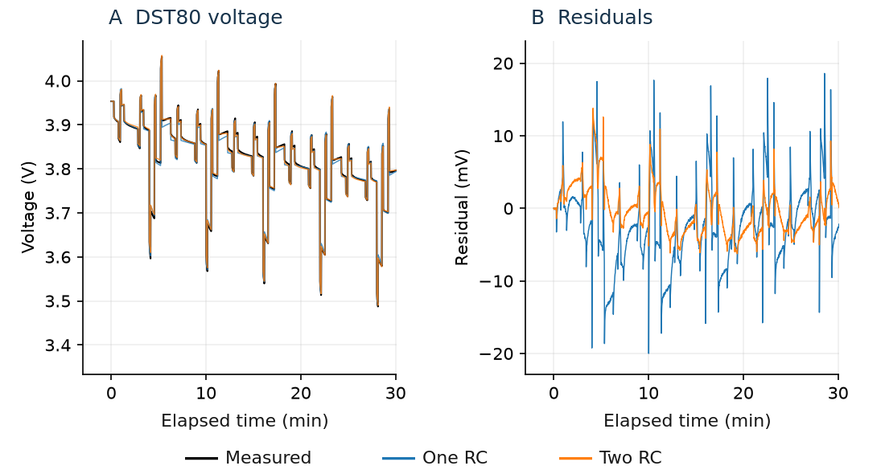
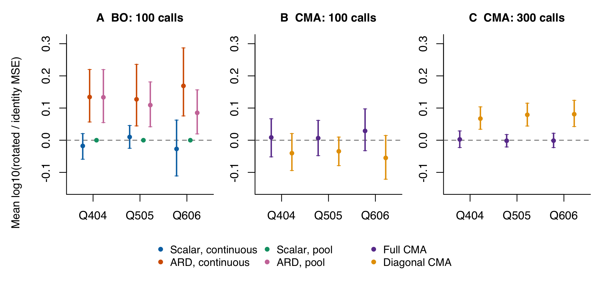
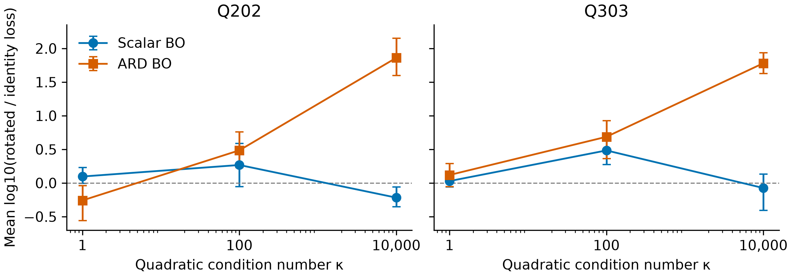
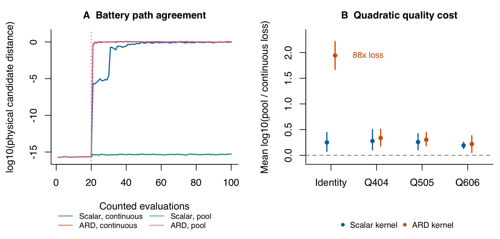
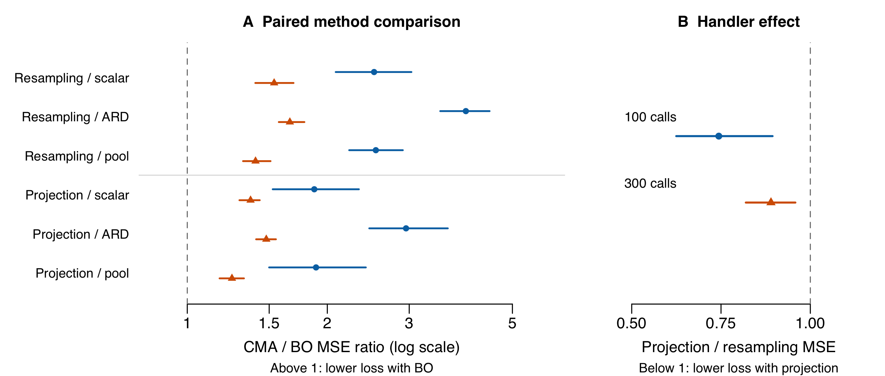

# Geometry and numerical search in Bayesian optimisation versus CMA-ES

DSA4212 · Final project

Mihir Sinha, A0273662Y · Rajvinder Dheepak Singh, A0277441B

Repository: [https://github.com/Rajvinder-d/DSA4212-Final-Project-BO-vs-CMA-ES](https://github.com/Rajvinder-d/DSA4212-Final-Project-BO-vs-CMA-ES)

### Abstract

We investigate how coordinate representation and numerical search affect Bayesian optimisation (BO) and CMA-ES on a measured battery-calibration objective. Domain-preserving rotations, fixed-history replays and candidate-pool interventions distinguish model symmetry from implemented search behaviour. Post hoc paired contrasts show larger signed rotation effects for ARD than scalar BO at 100 calls and for diagonal than full CMA at 300 calls; the CMA comparison at 100 calls is mixed. Exploratory quadratics showed increasing ARD penalties with conditioning. Corresponding pools restored scalar-BO path agreement while worsening optimisation on a quadratic control. At matched budgets of 100 and 300 calls, BO achieved lower loss than CMA in secondary paired comparisons across the nineteen complete designs. Projection reduced CMA's geometric-mean MSE by 26% at 100 calls and 11% at 300 calls, but separate box controls did not resolve its effect on rotation penalties. Continuous BO required much more search time in our implementation. These findings explain conditional differences in search behaviour without equating invariance, attained quality or computational efficiency.

## 1. Introduction

Bayesian optimisation fits a probabilistic surrogate to observed function values and selects evaluations through an acquisition function [1]. The covariance matrix adaptation evolution strategy (CMA-ES) ranks candidates and adapts a search distribution, including its covariance [2]. Both address black-box optimisation, but their use of information creates different advantages under limited evaluation budgets. Following the project brief [3], we test explanations for these behavioural differences.

Benchmark comparisons already show that BO–CMA rankings depend on landscape, dimension and search budget. Santoni et al. compare both families on BBOB functions and distinguish evaluation efficiency from computational cost [14]. BO has also been applied to battery-model identification [5,6]. Our contribution is a controlled investigation of representation and numerical search on a five-parameter battery objective, supported by quadratics with known curvature. We use measured CALCE current–voltage traces [4], but impose a rotation-invariant search domain to study optimiser behaviour. The resulting claims concern this optimisation experiment, rather than physical feasibility or a universally preferred battery-calibration method.

An orthogonal rotation preserves the physical problem when the feasible set is transformed consistently. It changes alignment with coordinate-specific structures: BO with automatic relevance determination (ARD) learns separate length scales along each axis, while diagonal CMA restricts covariance adaptation to those axes. An isotropic kernel preserves distances under rotation, although fitting and numerical acquisition search need not reproduce corresponding trajectories [2,7]. Mathematical symmetry therefore leaves an implementation question unresolved.

We ask how coordinate representation and conditioning influence rotation sensitivity, how much boundary handling resolves that sensitivity, and whether restoring search-path agreement improves solution quality. Scalar and ARD BO, full and diagonal CMA, and numerical interventions test distinct parts of that explanation. A boundary-handler experiment measures the BO–CMA quality gap at matched budgets and relates it to target accuracy and measured runtime.

<!-- page -->

## 2. Data and battery problem

The battery data comprise CALCE SP20-2 measurements at 25°C [4]. We use the DST profile from nominal 80% state of charge (SOC) for calibration and FUDS profiles from 80% and 50% SOC for assessment. Each window contains the preparatory rest sample and the following 3,600 s at native timestamps. Low-current measurements from a separate cell, SP20-3, approximate open-circuit voltage (OCV). We estimate a constant voltage offset from the DST preparatory rest and freeze it for all methods and assessments. Capacity is fixed at 2 Ah, with prescribed initial SOC and zero initial polarisation.

Table 1. Data roles, parameter bounds and search domains. The ball preserves the domain under rotation; it is not a validated physical feasibility boundary.

| Component | Definition or role |
| --- | --- |
| DST80 / FUDS80 / FUDS50 | Calibration / assessed prediction / assessed SOC transfer |
| R₀; R₁, R₂ | Ohmic resistance: 0.001–0.2 Ω; RC resistances: 0.0001–0.2 Ω |
| τ₁, τ₂ | RC time constants: 1–2,000 s; both branch orderings allowed |
| Primary domain / box control | ‖u‖₂ ≤ 1 / −1 ≤ uⱼ ≤ 1 in normalised log coordinates |

The equivalent circuit combines an ohmic resistance with two resistance–capacitance (RC) branches to model immediate and relaxing voltage drops [8]. For discharge-positive current I, interval Δtₖ and branch j ∈ {1,2}, let aⱼ,ₖ = exp(−Δtₖ/τⱼ). The branch voltage and terminal prediction follow

> vⱼ,ₖ = aⱼ,ₖ vⱼ,ₖ₋₁ + Rⱼ(1 − aⱼ,ₖ) Iₖ₋₁;   V̂ₖ = U(SOCₖ) + δ − R₀Iₖ − v₁,ₖ − v₂,ₖ.

Here U is the OCV approximation and δ is the fixed offset. SOC is updated by integrating current held constant over each interval. We minimise voltage mean squared error, L = N⁻¹Σₖ(V̂ₖ − Vₖ)², and report its square root as RMSE in mV. Repeated searches use the same measured traces, so the objective is deterministic. An affine mapping from normalised coordinates u to log parameters accommodates the different resistance and time scales.

Reference fits support using two RC branches. Bounded least squares in the full parameter box, with 300 simulator calls per fit, reduced DST RMSE from 6.25 to 3.97 mV and FUDS80 RMSE from 8.00 to 4.74 mV for one versus two branches. These diagnostics use residual information and a larger domain than the ball experiment; they are not black-box competitors or certified optima.

Figure 1. Measured DST80 voltage and one-/two-RC reference fits, with prediction-minus-measurement residuals. The first 30 minutes are shown without averaging; reported errors use the full hour. Repeated voltage responses follow the load cycle. The curves are full-box least-squares fits, not BO/CMA recommendations.

<!-- page -->

## 3. Problem statement and experimental design

### Methods and hypotheses

BO uses an exact Gaussian process with constant mean and Matérn-5/2 covariance, with scalar or five ARD length scales. Each step standardises negative loss and fits marginal likelihood for up to 60 iterations, starting length scales at 0.7 and output scale at 1. The length-scale bounds are [0.03, 5], and the output-scale bound is [0.01, 100]. Float64 fitting uses fixed variance 10⁻⁶ in standardised units to regularise deterministic observations, without additional input scaling. BoTorch's analytic log expected improvement (LogEI) selects evaluations [9,10]. Continuous search uses the best eight of 256 feasible starts, allowing 80 iterations each. Pool search scores 2,048 interior and 2,048 surface candidates, matched physically across rotations.

CMA starts at the best of twenty common initial observations, with population eight, covariance factor C = I and step size σ = 0.3; sampling covariance is σ²C. BO uses all twenty observations. Active updates, mirrors and extra diagonal decoding are disabled; diagonal learning rates match the full variant. No restarts or value-based early stops are used. Resampling rejects infeasible proposals; projection repairs them before evaluation and adaptation. Uniform random search supplies the baseline. Neither family was performance-tuned: these controlled settings do not establish optimally tuned performance.

H1 predicts rotation sensitivity from axis-specific length scales and diagonal covariance; scalar BO and full CMA provide comparison models. H2 predicts that corresponding candidate pools restore scalar-BO path agreement if numerical acquisition search contributes to divergence. We assess solution quality separately. H3 predicts that projection improves short-budget CMA loss when good solutions lie near the ball boundary. H2 and H3 were motivated by inspected results, so their evidence is exploratory rather than independent confirmation; the boundary experiment also reuses initial designs.

### Controls, budgets and uncertainty

Orthogonal Q preserves the ball under u = Qz. Q404/Q505/Q606 use QR factorisation of 5 × 5 Gaussian matrices seeded 404/505/606, with sign correction and determinant +1. Box controls enforce −1 ≤ Qz ≤ 1. Quadratics use f(u) = Σᵢwᵢ(uᵢ − aᵢ)²/Σᵢwᵢ, where wᵢ = exp[(i − 1) log(κ)/4], aᵢ = 0.25/√5 and i = 1,…,5. Their minimum is zero at a and their condition number is κ. The battery optimum is unknown. Each run recommends the lowest observed loss; FUDS assessment never guides search.

Table 2. Experiments grouped by question; version labels identify repository evidence. Budgets include twenty initial calls. Rotation experiments also include box, quadratic and length-scale-bound controls.

| Experiment | Initial designs and repetition | Counted calls | Trajectories |
| --- | --- | --- | ---: |
| Rotation and quality (v4) | Twenty primary designs; five CMA replicates; ten supporting designs | BO 100; CMA 300 | 3,160 |
| Pool and sampling controls (v3) | Ten battery designs; three CMA replicates | BO 100; CMA 300 | 885 |
| Fixed-history replays (v2) | Two reconstructed histories; six checkpoints | 80 history calls; separate reference search | — |
| Initial diagnostics (v1) | Three primary battery designs; smaller controls | 100 | 84 |
| Boundary and method comparison (v5) | Twenty planned designs; five replicates per CMA handler | All arms 300; checkpoint 100 | 279/280 complete |

Rotation and boundary experiments share the objective, initial-design construction and optimiser settings. The boundary experiment compares three BO variants, two full-CMA handlers and random search at 100 and 300 calls. Only the handler changes within the paired CMA comparison. The boundary experiment's method contrasts and timings come from one machine.

Rotation effects are R = log10(rotated/identity loss). Post hoc contrasts compare ARD − scalar and diagonal − full CMA values of R within designs, averaging five CMA replicate effects first. Percentile 95% intervals resample designs (rotation: 5,000, seed 4129; boundary: 10,000, seed 5129). Sample sizes reflect compute allocations; intervals are pointwise without multiplicity correction. Projection/resampling at 100 calls is the primary boundary contrast; others are secondary. Rejections cost time but no simulator call.

<!-- page -->

## 4. Results I: rotation sensitivity

### 4.1 Coordinate representation

A scalar kernel uses the squared distance ‖u − u′‖²/ℓ², which is preserved by rotation. ARD replaces the scalar weighting with D = diag(ℓ₁⁻²,…,ℓ₅⁻²). Under u = Qz, the squared distance becomes

> d² = (z − z′)ᵀ QᵀDQ (z − z′).

The transformed metric is generally dense, so another diagonal ARD metric cannot represent it. Full CMA can represent a rotated covariance Q C Qᵀ, whereas diagonal CMA fixes its principal axes to the chosen coordinates [2,7]. This difference predicts sensitivity to alignment even when the physical objective is unchanged. On the quadratic controls, rotation preserves the eigenvalues and condition number while changing alignment with these axes.

Figure 2. Battery rotation effects: mean log10(rotated/identity MSE), with pointwise 95% design-bootstrap intervals over twenty designs. All panels share the same vertical scale. (A–B) BO and resampling CMA at 100 calls. (C) CMA at 300 calls. Five CMA replicates are averaged within each design. Positive values favour the original orientation; intervals compare each method with itself, not BO directly with CMA.

Continuous ARD BO incurred higher battery loss under all three rotations (Figure 2A). Mean log10 effects ranged from 0.127 to 0.169, corresponding to approximately 34–48% higher geometric-mean MSE; each pointwise interval excluded zero (Table 3). The penalties persisted under pool search, with effects of 0.133, 0.109 and 0.085. Changing the acquisition procedure therefore retained ARD's sensitivity to alignment, supporting a contribution from the coordinate-specific model and its fitting.

Scalar continuous BO's rotation intervals spanned zero; scalar-pool paths and losses agreed to approximately floating-point precision. Direct post hoc ARD-minus-scalar contrasts were 0.152 [0.055, 0.255], 0.117 [0.025, 0.235] and 0.196 [0.144, 0.252] for Q404/Q505/Q606. Because scalar-pool effects are negligible at floating-point precision, the pool contrasts equal ARD-pool’s own effects at the reported precision: 0.133 [0.055, 0.220], 0.109 [0.042, 0.181] and 0.085 [0.020, 0.156]. All six pointwise intervals indicate a larger signed rotation effect for ARD. These direct comparisons support H1. Scalar intervals spanning zero do not establish equivalence.

### 4.2 CMA variation and attained quality

At 100 calls, diagonal CMA's rotation estimates were −0.040, −0.034 and −0.055, with every interval spanning zero (Figure 2B). At 300 calls, its rotated geometric-mean MSE was 17–20% higher than its original-orientation MSE (Figure 2C). Its log10 effects were 0.067 [0.034, 0.104], 0.079 [0.044, 0.115] and 0.081 [0.042, 0.124]. Full CMA's estimates were close to zero at 0.003, −0.002 and −0.001, with intervals spanning zero. At 100 calls, neither variant showed a clearly resolved signed penalty, and absolute orientation differences resembled variation between repeated searches in the original orientation.

Direct post hoc diagonal-minus-full contrasts at 300 calls were 0.065 [0.023, 0.106], 0.081 [0.040, 0.120] and 0.082 [0.034, 0.133] for Q404/Q505/Q606. At 100 calls they were −0.049 [−0.120, 0.024], −0.041 [−0.111, 0.026] and −0.084 [−0.172, −0.005]. Thus Q606 favoured a smaller signed diagonal effect at 100, while the other two were unresolved. This mixed early result qualifies H1; these are signed effects, not absolute sensitivity or an explicit budget-interaction test. Equal integer seeds do not yield corresponding physical Gaussian draws after rotation.

Table 3. Battery BO quality and rotation sensitivity at 100 calls. RMSE values are medians over twenty initial designs. R is the mean design-level log10(rotated/identity MSE), with pointwise 95% bootstrap intervals. The RMSE medians describe attained error; R measures the paired change from each method's own original orientation.

| Orientation | Scalar RMSE, mV | ARD RMSE, mV | Scalar R [95% interval] | ARD R [95% interval] |
| --- | ---: | ---: | --- | --- |
| Identity | 6.46 | 5.05 | Reference | Reference |
| Q404 | 6.66 | 5.39 | −0.018 [−0.059, 0.021] | 0.134 [0.057, 0.220] |
| Q505 | 6.49 | 5.64 | 0.010 [−0.025, 0.046] | 0.127 [0.044, 0.236] |
| Q606 | 6.44 | 6.21 | −0.027 [−0.111, 0.063] | 0.169 [0.075, 0.287] |

ARD retained lower median RMSE in every orientation despite its rotation penalty (Table 3): alignment sensitivity can coexist with better attained quality. These medians are descriptive; the direct contrasts above compare rotation effects, not absolute method quality.

### 4.3 Conditioning and boundary controls

ARD’s rotation penalty increased with quadratic conditioning in V3 (Figure 3). Across Q202/Q303, its signed effects ranged from −0.26 to 0.12 at κ = 1, 0.49–0.69 at κ = 100 and 1.78–1.86 at κ = 10,000. Scalar BO did not show the same increasing pattern. We therefore retained high conditioning as a supporting control in V4: with ten designs at κ = 10,000, continuous ARD effects were approximately 1.96–2.09. V3 used only five designs per condition; the observed pattern is exploratory, not a tested general conditioning law. The battery’s local Gauss–Newton curvature is not a known global condition number.

Figure 3. Exploratory V3 conditioning control at 100 calls. Points show mean signed rotation effects for scalar and ARD BO; bars show pointwise 95% design-bootstrap intervals over five designs per condition. Panels retain Q202 and Q303 separately. Lines connect the three tested condition numbers and do not represent a fitted trend. V4’s high-conditioning control uses different designs and rotations.

The same-box boundary interaction remained unresolved in V4 (Table 4). All twelve handler-by-rotation intervals and all six paired 300-minus-100-call interaction intervals span zero. V4 therefore did not establish the V3 Q202-specific reduction on new designs and rotations. This is an informative negative result, not evidence that boundary handling has no effect.

Table 4. Same-physical-box boundary interactions, R(projection) − R(resampling), with pointwise 95% intervals. R = log10(rotated/identity loss); negative interactions indicate a reduced signed rotation effect under projection. Five replicate effects are averaged within each of twenty independent designs before bootstrapping (5,000 resamples, seed 4129). Both handlers preserve the same physical feasible set.

| CMA variant | Rotation | 100 calls | 300 calls |
| --- | --- | --- | --- |
| Full | Q404 | -0.028 [-0.143, 0.080] | 0.025 [-0.087, 0.132] |
| Full | Q505 | -0.047 [-0.139, 0.045] | -0.043 [-0.114, 0.024] |
| Full | Q606 | -0.020 [-0.128, 0.081] | -0.014 [-0.094, 0.062] |
| Diagonal | Q404 | -0.027 [-0.113, 0.063] | 0.013 [-0.066, 0.089] |
| Diagonal | Q505 | 0.018 [-0.043, 0.078] | 0.022 [-0.041, 0.093] |
| Diagonal | Q606 | -0.022 [-0.083, 0.038] | -0.019 [-0.103, 0.073] |

Projection’s identity-ball quality improvement in Section 6 measures a different effect. Neither experiment estimates a percentage of rotation sensitivity attributable to boundaries. Raising the pool GP length-scale upper bound from 5 to 20 also improved some losses without a resolved change in rotation effect; every corresponding interval spanned zero.

## 5. Results II: numerical search and solution quality

### 5.1 Scalar-BO path divergence

Scalar BO followed different physical paths under rotation despite its kernel's rotational symmetry. A fixed-GP control tests whether the discrepancy is already present in predictions at corresponding observations and query points. With twenty initial observations and one hundred queries, maximum differences were 1.8 × 10⁻¹⁵ for posterior means, 6.7 × 10⁻¹⁶ for variances and 8.5 × 10⁻¹⁴ for LogEI. The fixed model therefore agreed to numerical precision, directing attention to fitting and candidate selection within the sequential search.

Replays of six checkpoints from two reconstructed histories hold physical observations and acquisition starts comparable across orientations. At one checkpoint, the selected candidates were approximately 0.81 apart in normalised physical coordinates, although their LogEI values under a common fitted model differed by only 0.0084. Increasing the acquisition iteration allowance from 80 to 240 left candidates unchanged at all six checkpoints. A larger allowance alone therefore did not resolve the discrepancy.

Separate replays of the original saved pilot histories also showed closely agreeing fitted predictions and a large candidate difference at the selected checkpoint. These replays used consistently mapped acquisition starts, rather than recovering the pilot's original acquisition random state. They support a discrepancy in candidate selection under controlled starts, without reconstructing the exact numerical sequence that produced the pilot paths. The small acquisition-value gap further shows that distant selected points can have similar estimated utility.

Acquisition search is itself a numerical optimisation problem. Selecting a different point changes the next observation and the history used for subsequent GP fits, allowing a local decision difference to propagate through the trajectory. LogEI improves the numerical behaviour of expected improvement [9], but does not ensure identical local-search outcomes after rotation. The replays support a contribution from acquisition search; they do not identify a particular solver operation or establish expected-improvement underflow as the cause.

### 5.2 Corresponding candidate pools

To test whether candidate selection explains the divergence, we replaced continuous acquisition optimisation with a common physical pool. At each step, we drew 2,048 uniform interior points and 2,048 surface points, mapped them into each orientation and selected the first maximum acquisition score. Kernel and fitting rules were unchanged. Fixed-history checks selected the same indexed physical candidate under both common and independently fitted scalar models.

This agreement persisted in sequential scalar-pool searches. The maximum final battery distance was below 10⁻¹⁵, compared with a median of approximately 0.873 for scalar continuous BO across sixty design–rotation pairs. ARD-pool paths still diverged (Figure 4A). The intervention therefore restored scalar-BO agreement while retaining the divergence associated with coordinate-specific length scales.

The pool also restricts where the optimiser can evaluate. Half its candidates lie on the surface, and continuous search can reach points absent from the finite set. Restored agreement may therefore come with a change in solution quality. We assessed this separately using paired pool/continuous loss contrasts on both objectives.

### 5.3 Quality under pool search

Figure 4. Path agreement and attained quality. (A) Battery candidate distances in physical coordinates, averaged over three rotations within each design, then summarised by the median over twenty designs. Values are floored at 10⁻¹⁶ for display; the dotted line marks the end of twenty initial evaluations. (B) Mean design-level log10(pool/continuous loss) on the κ = 10,000 quadratic at 100 calls, with pointwise 95% bootstrap intervals over ten designs. Positive values indicate higher pool loss. The panels compare path agreement on the battery with quality on the quadratic.

Pool search reduced ARD's quadratic rotation penalties from approximately 1.96–2.09 to 0.36–0.42, but worsened absolute loss for both kernels in every orientation. Each of the eight pointwise paired pool/continuous intervals was positive (Figure 4B). In the original orientation, ARD's log10 ratio was 1.945 [1.674, 2.216], corresponding to approximately 88 times the geometric-mean loss. The smaller rotation penalty partly reflected degraded original-orientation performance. The smaller penalty therefore gave a misleading impression of improvement when considered without absolute loss.

A finite pool may miss points that continuous acquisition search can reach along a narrow valley. This could explain the quadratic deterioration, although the fixed pool size and coverage prevent separating this effect from other consequences of pool search. The battery comparison was less consistent: all scalar-pool quality intervals included zero, while ARD-pool was worse at identity and Q505 and remained uncertain at the other orientations. Pool search's effect on quality thus differed between the objectives and kernel representations.

The replays and pool intervention support H2: numerical acquisition search contributes to scalar-BO path divergence. Scalar continuous paths differed without a resolved signed quality penalty; matching scalar-pool paths did not improve quadratic quality. Mathematical symmetry, implemented trajectories and attained loss therefore answer different questions.

## 6. Results III: BO–CMA quality, boundary handling and cost

### 6.1 Matched evaluation budgets

At each budget, BO achieved lower loss than CMA in all six secondary paired comparisons; each pointwise interval favoured BO (Figure 5A). The experiment completed 279 of 280 trajectories. One scalar-BO run stopped after 166 calls because all eight acquisition restarts returned infeasible candidates. To preserve pairing, the main analysis uses the remaining nineteen complete designs at both budgets.

Figure 5. Matched-budget geometric-mean MSE ratios with pointwise 95% bootstrap intervals over nineteen complete initial designs; CMA log losses are averaged over five replicates per design. Blue circles: 100 calls; orange triangles: 300. (A) Six CMA/BO comparisons at each budget, on a logarithmic horizontal axis; values above one favour BO. Pool denotes scalar-pool BO. (B) Projection/resampling, on a linear axis; values below one favour projection. Only the 100-call handler contrast is primary. The intervals do not provide simultaneous coverage.

Table 5. Matched-budget quality, boundary occupancy and cost on the nineteen complete designs. RMSE, surface fractions and search times are descriptive medians; hits are run counts. A surface evaluation has 1 − ‖u‖ ≤ 10⁻⁸; fractions include the twenty initial calls. Search time includes logging but excludes setup and final assessments. Within the nineteen complete designs, each CMA handler contributes 95 runs (five replicates per design); both handlers completed all twenty designs. Other methods have nineteen runs.

| Method | RMSE 100 / 300, mV | Median surface fraction at 100 calls, % | Time at 300, s | 6 mV hits by 300 |
| --- | ---: | ---: | ---: | ---: |
| Scalar BO | 6.45 / 4.76 | 73.0 | 401.45 | 18/19 |
| ARD BO | 5.13 / 4.73 | 79.0 | 428.26 | 19/19 |
| Scalar pool BO | 6.41 / 5.15 | 69.0 | 52.03 | 19/19 |
| CMA, resampling | 10.22 / 6.05 | 0.0 | 0.896 | 43/95 |
| CMA, projection | 8.36 / 5.95 | 40.0 | 0.871 | 53/95 |
| Random | 14.55 / 12.53 | 0.0 | 0.840 | 0/19 |

Both adaptive families improved substantially on uniform random search, whose median error remained 12.53 mV at 300 calls and which never reached 6 mV. This descriptive baseline shows the benefit of guided search on this objective. BO's lower median errors coexist with much greater runtime; accuracy requirements determine the practical value of that difference.

### 6.2 Boundary handling and computational cost

Projection reduced CMA's geometric-mean MSE at 100 calls by approximately 26%: the paired projection/resampling ratio was **0.744 [0.625, 0.894]**, with improvement in sixteen of nineteen designs. The median distance of the recommended point from the ball boundary fell from 0.088 to approximately zero. At 300 calls the ratio was **0.890 [0.819, 0.958]**, also favouring projection. These results support H3, but projection changes both accepted candidates and subsequent adaptation; surface access is not isolated. The intervention supports boundary handling as a contributor to the early quality gap, although BO retained lower loss under both CMA handlers.

By 300 calls, projection reached 10 mV in 95/95 runs and resampling in 94/95, with median times of 0.236 and 0.311 s among runs that reached it. BO reached that target in 19/19 runs per variant; variant-specific median times ranged from 1.59 to 19.73 s. The stricter 6 mV target separated methods more strongly (Table 5). Continuous BO spent about 0.66 s evaluating the objective within 401–428 s of search. Its low per-evaluation cost was therefore offset by substantial decision overhead in this CPU/NumPy implementation. Target hit counts follow COCO reporting [11]; matched-call results do not establish an equal-time quality ranking.

## 7. Discussion

Direct contrasts support larger signed ARD effects under both acquisition procedures and larger diagonal-CMA effects at 300 calls. The mixed CMA comparison at 100 limits a blanket sensitivity claim. Numerical acquisition search contributes to the path divergence. Scalar-GP predictions agreed under rotation, yet numerical selection produced divergent paths; pools restored agreement while worsening quadratic loss. Symmetry, trajectory agreement and solution quality are therefore distinct outcomes.

The practical comparison depends on the required accuracy and the resource being limited. BO attained lower error at the tested evaluation budgets, while CMA reached 10 mV with much less elapsed time. For this cheap simulator, fitting and searching a surrogate dominated continuous BO's runtime. More expensive evaluations could change that balance, but no evaluation-cost sweep or equal-time experiment was performed. Projection improved identity-ball CMA quality without removing the matched-call BO advantage. The same-box rotation interaction remained unresolved; the two boundary experiments cannot be combined into an attributable fraction.

The BO–CMA comparison is conditional on complete designs, so excluding one design may bias its estimated advantage. Both CMA handlers completed all twenty designs; a post hoc analysis retaining all twenty designs still favoured projection at both budgets. The handler finding therefore does not depend on excluding the incomplete BO design.

At 300 calls, scalar/ARD BO median FUDS80 RMSE was 5.71/5.70 mV, versus 7.36/7.31 for resampling/projected CMA; FUDS50 medians were 5.38/5.23 versus 6.73/6.55 mV. These FUDS profiles assess frozen recommendations on one cell, not independent cell replication or unique parameter recovery, because exchanging RC branches preserves predictions [12]. The controls do not isolate representation from fitting or covariance learning from mean and step-size adaptation. Findings remain conditional on selected windows and rotations, the artificial ball, controlled settings and fixed OCV/SOC assumptions. The best among the saved reference fits in the ball has 5.90 mV RMSE; optimiser runs attained lower errors, so this reference is not an optimum. Pointwise intervals quantify design variability, not uncertainty over cells or all orientations. Further tests could vary pool coverage, examine another cell or compare local BO models such as TuRBO [13].

### Reproducibility and evidence

The repository contains the report source, figures and numerical evidence. Saved boundary-study losses support numerical checks; fresh experiments require CALCE download/preparation and the recorded environment. The checkout omits historical candidate arrays and manifests, so the original executions cannot be fully audited. The boundary-study implementation and exported results are included in the repository (`src/bo_vs_es/` and `results/v5-aligned/`). Our division of labour, including the members’ research, execution and editorial roles, is recorded in the [contribution record](https://github.com/Rajvinder-d/DSA4212-Final-Project-BO-vs-CMA-ES/blob/main/docs/STUDENT_ENGAGEMENT.md).

<!-- page -->

## 8. Conclusion

Coordinate-specific models and numerical acquisition search explain different aspects of optimiser behaviour. Post hoc paired contrasts support larger signed ARD rotation effects at 100 calls and diagonal-CMA effects at 300 calls; the CMA comparison at 100 calls was mixed. The exploratory conditioning trend reinforces ARD’s alignment sensitivity. The pool intervention links scalar-BO path divergence to numerical selection, but restoring path agreement did not ensure better quality. Projection improved CMA's ball-domain loss, although its contribution to rotation effects on the box remained unresolved. Across nineteen complete designs, BO attained lower loss at matched budgets, while CMA reached the looser accuracy target much faster. Method choice therefore depends on the required accuracy and resource budget, as well as representation and constraint handling.

## References

[1] Frazier PI. A Tutorial on Bayesian Optimization. 2018. [arXiv:1807.02811](https://arxiv.org/abs/1807.02811).

[2] Hansen N. The CMA Evolution Strategy: A Tutorial. 2016; revised 2023. [arXiv:1604.00772](https://arxiv.org/abs/1604.00772).

[3] Thiéry A. Bayesian optimisation versus evolutionary strategies. DSA4212 project brief. [Teaching page](https://alexxthiery.github.io/teaching/bo-vs-es/bo-vs-es.html). Accessed 12 November 2026.

[4] CALCE, University of Maryland. Battery Research Data. [Data catalogue](https://calce.umd.edu/data). Selected SP20-2 DST/FUDS and SP20-3 low-current OCV archives; source hashes recorded in the repository.

[5] Pi J, da Silva SF, Ozkan MF, Gupta A, Canova M. Parameter Identification for Electrochemical Models of Lithium-Ion Batteries Using Bayesian Optimization. 2024. [arXiv:2405.10750](https://arxiv.org/abs/2405.10750).

[6] Tu H, Lin X, Wang Y, Fang H. System Identification for Lithium-Ion Batteries with Nonlinear Coupled Electro-Thermal Dynamics via Bayesian Optimization. American Control Conference; 2024. [arXiv:2405.20219](https://arxiv.org/abs/2405.20219).

[7] Rasmussen CE, Williams CKI. Gaussian Processes for Machine Learning. MIT Press; 2006. Chapter 4: [Covariance Functions](https://gaussianprocess.org/gpml/chapters/RW4.pdf).

[8] Tian N, Wang Y, Chen J, Fang H. On Parameter Identification of an Equivalent Circuit Model for Lithium-Ion Batteries. IEEE Conference on Control Technology and Applications; 2017. [MERL TR2017-123](https://www.merl.com/publications/docs/TR2017-123.pdf).

[9] Ament S, Daulton S, Eriksson D, Balandat M, Bakshy E. Unexpected Improvements to Expected Improvement for Bayesian Optimization. NeurIPS; 2023. [arXiv:2310.20708](https://arxiv.org/abs/2310.20708).

[10] Balandat M, Karrer B, Jiang DR, Daulton S, Letham B, Wilson AG, Bakshy E. BoTorch: A Framework for Efficient Monte-Carlo Bayesian Optimization. NeurIPS; 2020. [arXiv:1910.06403](https://arxiv.org/abs/1910.06403).

[11] Hansen N, Auger A, Ros R, Mersmann O, Tušar T, Brockhoff D. COCO: A Platform for Comparing Continuous Optimizers in a Black-Box Setting. 2016; revised 2020. [arXiv:1603.08785](https://arxiv.org/abs/1603.08785).

[12] Grandjean TRB, McGordon A, Jennings PA. Structural Identifiability of Equivalent Circuit Models for Li-Ion Batteries. Energies. 2017;10(1):90. [doi:10.3390/en10010090](https://doi.org/10.3390/en10010090).

[13] Eriksson D, Pearce M, Gardner JR, Turner R, Poloczek M. Scalable Global Optimization via Local Bayesian Optimization. NeurIPS; 2019. [arXiv:1910.01739](https://arxiv.org/abs/1910.01739).

[14] Santoni ML, Raponi E, De Leone R, Doerr C. Comparison of High-Dimensional Bayesian Optimization Algorithms on BBOB. 2023; revised 2024. [arXiv:2303.00890](https://arxiv.org/abs/2303.00890).
